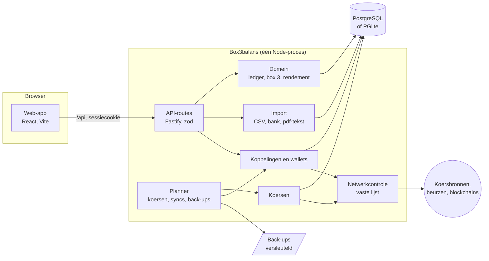

# Architectuur

_English: [en/architectuur.md](en/architectuur.md)_

Hoe Box3balans in elkaar zit: de onderdelen, hoe gegevens erdoorheen gaan, en waar je wat vindt. Waarom het zo is, staat per keuze in de [ADR's](adr/); de woorden komen uit [CONTEXT.md](../CONTEXT.md).

## In één oogopslag

- **Eén server, één proces.** Fastify serveert de API en de gebouwde web-app (`web/dist`). Er is geen aparte worker of wachtrij: een ingebouwde planner doet het periodieke werk ([ADR 0001](adr/0001-zelf-hosten.md)).
- **Eén database.** PostgreSQL in Docker Compose, of PGlite in het proces zelf (één container, ontwikkelen, tests); dezelfde migraties en queries ([ADR 0002](adr/0002-postgresql-en-pglite.md)).
- **De browser praat alleen met de eigen server.** De Content-Security-Policy staat alleen `'self'` toe; alles wat naar buiten gaat, gaat via de server en de netwerkcontrole ([ADR 0011](adr/0011-vaste-lijst-van-bestemmingen.md)).

## De server (`server/src`)

| Map                  | Wat erin zit                                                                                                                                                                                                                                                                                                                                                                                                                                                                                    |
| -------------------- | ----------------------------------------------------------------------------------------------------------------------------------------------------------------------------------------------------------------------------------------------------------------------------------------------------------------------------------------------------------------------------------------------------------------------------------------------------------------------------------------------- |
| `index.ts`, `app.ts` | Opstarten: configuratie lezen (`config.ts`), de netwerkcontrole installeren, de database openen en migreren, de diensten maken en de planner starten. `app.ts` bouwt de Fastify-app: beveiligingsheaders, sessies, de CSRF-controle, rate limits en de routes.                                                                                                                                                                                                                                  |
| `routes/`            | Eén bestand per onderwerp (rekeningen, transacties, box 3, imports, back-ups …). Elke route controleert zijn invoer met een zod-schema en roept het domein aan; rekenen gebeurt niet in de routes.                                                                                                                                                                                                                                                                                              |
| `domain/`            | Het rekenwerk, zonder HTTP. `ledger.ts` speelt transacties af tot posities met aankoopwaarde (gemiddeld of FIFO); `valuation.ts` waardeert ze op een dag; `box3.ts` rekent de forfaitaire box 3 uit; `box3Actual.ts` het werkelijk rendement; `box3Future.ts` de vooruitblik op 2028; `history.ts`, `returns.ts` en `performance.ts` het vermogen en rendement door de tijd; `attention.ts` de lijst _Aandacht nodig_.                                                                          |
| `rules/`             | De belastingregels per jaar als data (`box3.json`), gecontroleerd bij het starten ([belastingregels.md](belastingregels.md)).                                                                                                                                                                                                                                                                                                                                                                   |
| `import/`            | Bestanden inlezen. `parse.ts` leest CSV (scheidingsteken, notatie, codering); `formats/` herkent exports van aanbieders; `mapping.ts` zet kolommen om naar transacties; `plan.ts` maakt het voorbeeld (nieuw, al geïmporteerd, mogelijk dubbel); `bank.ts` leest bankexports, `statement.ts` portefeuille-overzichten, `yearStatement.ts` de tekst van jaaroverzichten, `contribute.ts` maakt een formaat om te delen zonder gegevens ([ADR 0012](adr/0012-formaten-delen-zonder-gegevens.md)). |
| `sync/`              | Koppelingen met beurzen en brokers: per aanbieder een client in `providers/`, en gedeeld: importeren, overboekingen koppelen, saldi vergelijken, waarden van beloningen bijwerken.                                                                                                                                                                                                                                                                                                              |
| `wallets/`           | Adressen op blockchains volgen: per keten een lezer (Bitcoin, EVM, Solana, Cardano …) en het verrekenen van eigen adressen (`netting.ts`).                                                                                                                                                                                                                                                                                                                                                      |
| `prices/`            | Koersen en wisselkoersen: per bron een client, een terugval als de hoofdbron niets geeft, en koersgeschiedenis alleen als vaststaat dat het dezelfde munt is ([ADR 0004](adr/0004-koersgeschiedenis-alleen-met-zekerheid.md)).                                                                                                                                                                                                                                                                  |
| `jobs/`              | De planner (koersen elke `PRICE_REFRESH_MINUTES`, syncs elke `SYNC_INTERVAL_HOURS`, back-ups elk uur gecontroleerd) en het bijladen van koersgeschiedenis.                                                                                                                                                                                                                                                                                                                                      |
| `backup/`            | Back-ups maken en terugzetten, versleuteld met AES-256-GCM (sleutel via scrypt), en de wachtzin.                                                                                                                                                                                                                                                                                                                                                                                                |
| `auth/`              | Gebruiker, sessies (willekeurige tokens, gehasht opgeslagen), argon2id-wachtwoorden en tweestapsverificatie (TOTP).                                                                                                                                                                                                                                                                                                                                                                             |
| `lib/`               | Gedeelde bouwstenen: `net.ts` (de lijst van bestemmingen en de controle op `fetch`), `secrets.ts` (API-sleutels versleutelen), `decimal.ts` (exacte bedragen), `time.ts` (dagen in de ingestelde tijdzone, [ADR 0003](adr/0003-dagen-in-nederlandse-tijd.md)), `audit.ts` (de wijzigingsgeschiedenis).                                                                                                                                                                                          |
| `db/`                | Het schema (Drizzle) en de verbinding; migraties staan in `server/drizzle/`.                                                                                                                                                                                                                                                                                                                                                                                                                    |
| `cli.ts`             | Onderhoud vanaf de opdrachtregel: back-up, terugzetten, ontsleutelen, tweestapsverificatie uitzetten.                                                                                                                                                                                                                                                                                                                                                                                           |

## De web-app (`web/src`)

- **Pagina's** (`pages/`): één per scherm, met TanStack Query voor de gegevens van de API. De pagina's tonen wat de server uitrekende; ze rekenen zelf niet.
- **Onderdelen** (`components/`, `charts/`): de gedeelde bouwstenen (`ui.tsx`), de layout met navigatie, en de grafieken (Recharts).
- **`App.tsx`** regelt inloggen en de eerste installatie; **`main.tsx`** zet de app neer.
- **`api.ts`** haalt op bij de API en heeft de types van de antwoorden. Waar de server hetzelfde type heeft, controleert `web/contract/api.ts` de kopie daartegen: `npm run typecheck` faalt als een veld dat de web-app verwacht weg is, anders heet of een ander type heeft.
- **Teksten** staan in het Engels in de code en worden vertaald met `i18n/nl.ts`.
- **Pdf's** worden in de browser gelezen (`pdfText.ts`, pdf.js); alleen de tekst gaat naar de server ([ADR 0009](adr/0009-pdf-lezen-in-de-browser.md)).
- **De online demo** is dezelfde app, gebouwd met `--mode online-demo`: `staticDemo.ts` beantwoordt de vragen uit een opname in plaats van een server ([ADR 0010](adr/0010-online-demo-zonder-server.md)).

## Hoe gegevens erdoorheen gaan

1. **Erin:** met de hand (een formulier stuurt JSON naar een route), uit een bestand (de browser leest het, de server maakt een voorbeeld en slaat pas op na bevestiging), via een koppeling of wallet (de planner of een knop start een sync), of als waarden per jaar.
2. **Opgeslagen:** transacties, rekeningen, waarden per jaar, koersen per dag, in `NUMERIC`-kolommen. Elke wijziging komt in `audit_log`.
3. **Uitgerekend bij het opvragen:** posities, rendement en box 3 worden uit de transacties en koersen afgeleid, niet als uitkomst bewaard. Zo klopt alles meteen na een wijziging of een andere instelling (zoals FIFO).
4. **Eruit:** de pagina's, CSV-exports, het dossier per jaar en back-ups.

## Wat naar buiten gaat

Alleen de server maakt verbinding met internet, alleen via `fetch`, en alleen met de adressen in `lib/net.ts` (per functie uit te zetten). Wat er per functie verstuurd wordt, staat in [privacy.md](privacy.md); dat bedragen nooit naar buiten gaan, volgt uit welke gegevens de clients meesturen (symbolen, ISIN's, adressen, verzoeken met je eigen sleutel).

## Bouwen, testen en uitbrengen

- **npm-workspaces:** `server` en `web`, elk met TypeScript in strikte modus, ESLint met type-informatie en Prettier.
- **Tests:** Vitest. De server met een echte database (PGlite) en nagebootste externe API's (een test die het internet op gaat, faalt); de web-app met Testing Library tegen de opgenomen antwoorden van het demohuishouden. `npm run coverage` meet hoeveel van de code de tests raken.
- **CI** (GitHub Actions): lint, typecontrole, tests met dekking, CodeQL, ShellCheck en actionlint, tests op lastige datums, een controle dat het image alleen adressen van de lijst benadert, en het multi-arch-image, ondertekend met cosign. Uitgaven: zie [releasen.md](releasen.md).
- **Docker:** één image met de server en de gebouwde web-app; de entrypoint maakt de geheimen bij de eerste start aan en draait de app als gewone gebruiker.
