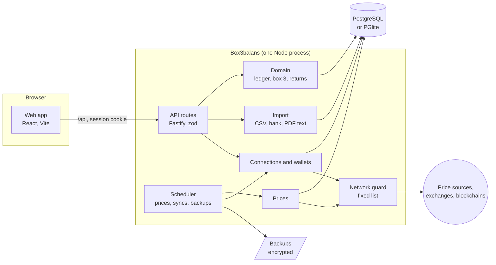

# Architecture

_Nederlands: [architectuur.md](../architectuur.md)_

How Box3balans fits together: the parts, how data flows through them, and where to find what. Why it's this way is in the [ADRs](adr/), one per decision; the terms come from [CONTEXT.en.md](../../CONTEXT.en.md).

## At a glance

- **One server, one process.** Fastify serves the API and the built web app (`web/dist`). There's no separate worker or queue: a built-in scheduler does the periodic work ([ADR 0001](adr/0001-zelf-hosten.md)).
- **One database.** PostgreSQL in Docker Compose, or PGlite inside the process (single container, development, tests); the same migrations and queries ([ADR 0002](adr/0002-postgresql-en-pglite.md)).
- **The browser only talks to its own server.** The Content-Security-Policy only allows `'self'`; everything that goes out goes through the server and the network guard ([ADR 0011](adr/0011-vaste-lijst-van-bestemmingen.md)).

## The server (`server/src`)

| Folder               | What's in it                                                                                                                                                                                                                                                                                                                                                                                                                                                              |
| -------------------- | ------------------------------------------------------------------------------------------------------------------------------------------------------------------------------------------------------------------------------------------------------------------------------------------------------------------------------------------------------------------------------------------------------------------------------------------------------------------------- |
| `index.ts`, `app.ts` | Startup: read the configuration (`config.ts`), install the network guard, open and migrate the database, create the services and start the scheduler. `app.ts` builds the Fastify app: security headers, sessions, the CSRF check, rate limits and the routes.                                                                                                                                                                                                            |
| `routes/`            | One file per subject (accounts, transactions, box 3, imports, backups …). Every route checks its input with a zod schema and calls the domain; no calculating happens in the routes.                                                                                                                                                                                                                                                                                      |
| `domain/`            | The calculations, without HTTP. `ledger.ts` replays transactions into positions with a cost basis (average or FIFO); `valuation.ts` values them on a day; `box3.ts` calculates the deemed-return box 3; `box3Actual.ts` the actual return; `box3Future.ts` the 2028 preview; `history.ts`, `returns.ts` and `performance.ts` wealth and returns over time; `attention.ts` the _Needs attention_ list.                                                                     |
| `rules/`             | The tax rules per year as data (`box3.json`), checked at startup ([belastingregels.md](belastingregels.md)).                                                                                                                                                                                                                                                                                                                                                              |
| `import/`            | Reading files. `parse.ts` reads CSV (separator, notation, encoding); `formats/` recognises providers' exports; `mapping.ts` turns columns into transactions; `plan.ts` makes the preview (new, already imported, possible duplicate); `bank.ts` reads bank exports, `statement.ts` portfolio statements, `yearStatement.ts` the text of annual statements, `contribute.ts` makes a format to share without data ([ADR 0012](adr/0012-formaten-delen-zonder-gegevens.md)). |
| `sync/`              | Connections with exchanges and brokers: a client per provider in `providers/`, and shared: importing, linking transfers, comparing balances, updating the values of rewards.                                                                                                                                                                                                                                                                                              |
| `wallets/`           | Following addresses on blockchains: a reader per chain (Bitcoin, EVM, Solana, Cardano …) and settling your own addresses against each other (`netting.ts`).                                                                                                                                                                                                                                                                                                               |
| `prices/`            | Prices and exchange rates: a client per source, a fallback when the main source gives nothing, and price history only when it's certain to be the same coin ([ADR 0004](adr/0004-koersgeschiedenis-alleen-met-zekerheid.md)).                                                                                                                                                                                                                                             |
| `jobs/`              | The scheduler (prices every `PRICE_REFRESH_MINUTES`, syncs every `SYNC_INTERVAL_HOURS`, backups checked hourly) and loading price history.                                                                                                                                                                                                                                                                                                                                |
| `backup/`            | Making and restoring backups, encrypted with AES-256-GCM (key via scrypt), and the passphrase.                                                                                                                                                                                                                                                                                                                                                                            |
| `auth/`              | The user, sessions (random tokens, stored hashed), argon2id passwords and two-step verification (TOTP).                                                                                                                                                                                                                                                                                                                                                                   |
| `lib/`               | Shared building blocks: `net.ts` (the list of destinations and the check on `fetch`), `secrets.ts` (encrypting API keys), `decimal.ts` (exact amounts), `time.ts` (days in the configured time zone, [ADR 0003](adr/0003-dagen-in-nederlandse-tijd.md)), `audit.ts` (the change history).                                                                                                                                                                                 |
| `db/`                | The schema (Drizzle) and the connection; migrations are in `server/drizzle/`.                                                                                                                                                                                                                                                                                                                                                                                             |
| `cli.ts`             | Maintenance from the command line: backup, restore, decrypt, turn off two-step verification.                                                                                                                                                                                                                                                                                                                                                                              |

## The web app (`web/src`)

- **Pages** (`pages/`): one per screen, with TanStack Query for the API's data. The pages show what the server calculated; they don't calculate themselves.
- **Components** (`components/`, `charts/`): the shared building blocks (`ui.tsx`), the layout with navigation, and the charts (Recharts).
- **`App.tsx`** handles signing in and the first installation; **`main.tsx`** mounts the app.
- **`api.ts`** fetches from the API and has the types of its answers. Where the server has the same type, `web/contract/api.ts` checks the copy against it: `npm run typecheck` fails when a field the web expects is gone, renamed or of another type.
- **Texts** are in English in the code and translated with `i18n/nl.ts`.
- **PDFs** are read in the browser (`pdfText.ts`, pdf.js); only the text goes to the server ([ADR 0009](adr/0009-pdf-lezen-in-de-browser.md)).
- **The online demo** is the same app, built with `--mode online-demo`: `staticDemo.ts` answers the requests from a recording instead of a server ([ADR 0010](adr/0010-online-demo-zonder-server.md)).

## How data flows through it

1. **In:** by hand (a form sends JSON to a route), from a file (the browser reads it, the server makes a preview and only saves after confirmation), via a connection or wallet (the scheduler or a button starts a sync), or as values per year.
2. **Stored:** transactions, accounts, values per year, daily prices, in `NUMERIC` columns. Every change goes into `audit_log`.
3. **Calculated on request:** positions, returns and box 3 are derived from the transactions and prices, not stored as results. That way everything is right immediately after a change or a different setting (such as FIFO).
4. **Out:** the pages, CSV exports, the dossier per year and backups.

## What goes out

Only the server connects to the internet, only via `fetch`, and only to the hosts in `lib/net.ts` (each feature can be switched off). What each feature sends is in [privacy.md](privacy.md); that amounts never go out follows from what the clients send (symbols, ISINs, addresses, requests signed with your own key).

## Building, testing and releasing

- **npm workspaces:** `server` and `web`, each with TypeScript in strict mode, ESLint with type information and Prettier.
- **Tests:** Vitest. The server with a real database (PGlite) and simulated external APIs (a test that goes to the internet fails); the web app with Testing Library against the demo household's recorded answers. `npm run coverage` measures how much of the code the tests reach.
- **CI** (GitHub Actions): lint, typecheck, tests with coverage, CodeQL, ShellCheck and actionlint, tests at tricky dates, a check that the image only contacts hosts on the list, and the multi-arch image, signed with cosign. Releases: see [releasen.md](releasen.md).
- **Docker:** one image with the server and the built web app; the entrypoint creates the secrets on first start and runs the app as a normal user.
